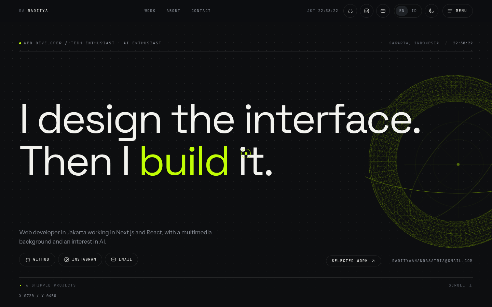
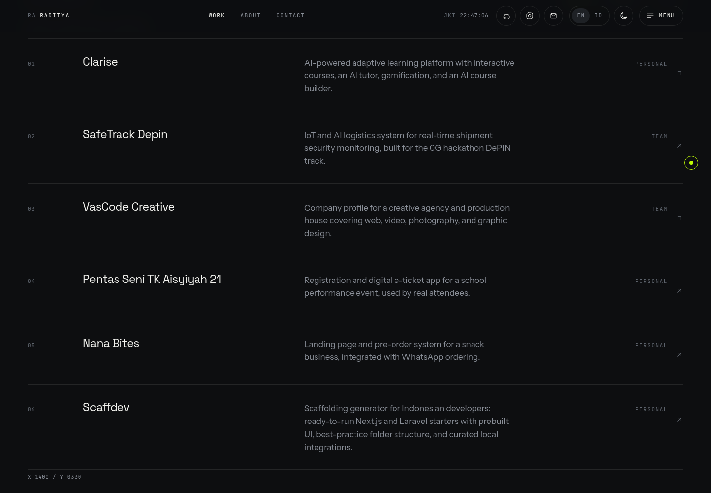
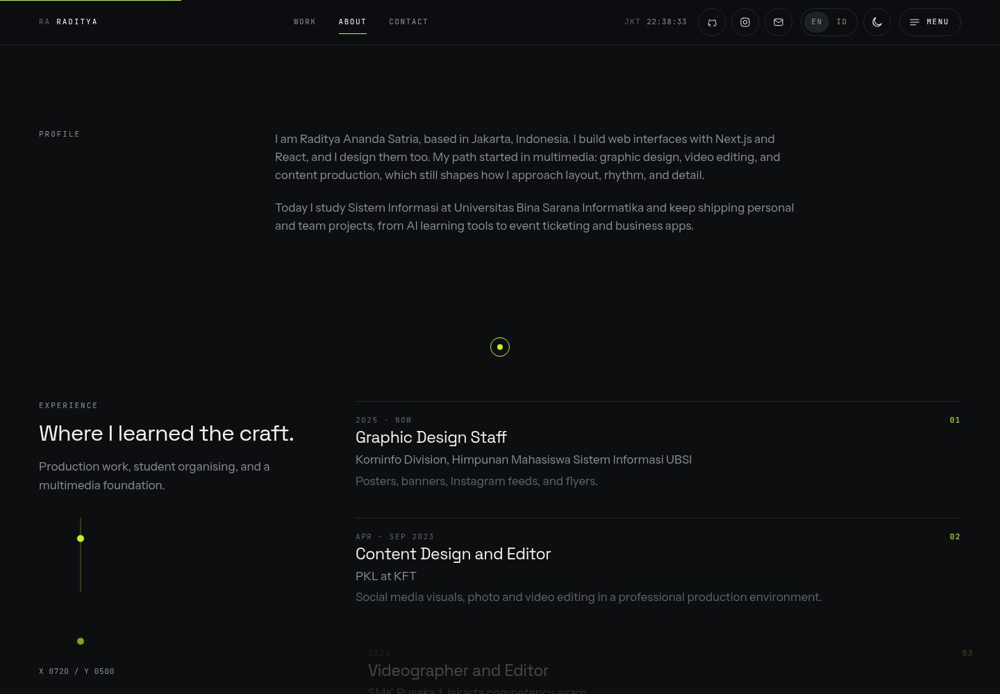
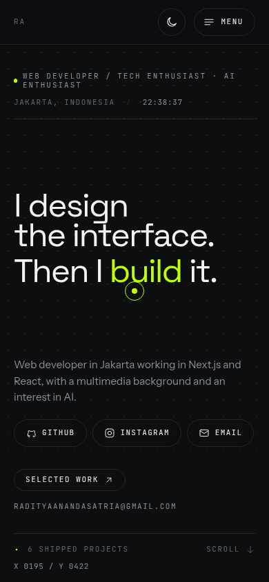

<div align="center">

# RADITYA

### Web developer / tech enthusiast · AI enthusiast

I design the interface. Then I build it.

[Repository](https://github.com/Radityaaa25/new-porto-raditya) · [Email](mailto:radityaanandasatria@gmail.com) · [GitHub](https://github.com/Radityaaa25) · [Instagram](https://instagram.com/rdityaas)


</div>



A portfolio built like a product: an editorial interface with a technical HUD, motion that
answers the scroll, and content that is typed, translated, and editable in one place.

No template. No page builder. No stock character. Every visual asset is generated, captured, or
drawn for this site.

---

## The idea

- **Two voices.** Space Grotesk for display, Instrument Sans for reading, JetBrains Mono for
  telemetry, labels, and coordinates.
- **One signal.** A single lime accent, `#c0fe04`, used as a mark and a hover ink, never as a
  surface.
- **Motion with a job.** Lenis smooth scroll, GSAP ScrollTrigger set-pieces, view transitions on
  filters, an original wireframe set-piece rendered with OGL, and an SVG character in the closing
  sections.
- **A real interface, not a video.** Every project links to a live site, every screenshot is
  captured from production, and the project index previews on hover.
- **Bilingual by construction.** English and Indonesian routes share one typed content model.
- **Motion is optional.** Reduced motion collapses movement, the 3D scene does not mount, and the
  custom cursor only appears on fine pointers.





<p align="center">
  
</p>

---

## System

| Layer | Choice |
|---|---|
| Framework | Next.js 16 App Router |
| Language | TypeScript 5.9 |
| Styling | Tailwind CSS 4 plus CSS variables |
| Motion | GSAP 3.15, ScrollTrigger, Lenis |
| 3D | OGL, one original wireframe torus |
| i18n | next-intl, `en` and `id`, prefix always |
| Images | next/image, AVIF and WebP, generated with sharp |
| Hosting | Vercel |

Tokens live in `styles/tokens.css`. Tailwind and TypeScript read the same values, so colour,
spacing, type, duration, and easing never drift into components.

```
app/[locale]/          routes: home, work, work/[slug], about, contact
components/
  hud/                 clock, theme, language, cursor, scroll progress
  layout/              header, footer, menu, route curtain
  motion/              preloader, split text, reveal, scrub, parallax
  sections/            page sections and set-pieces
  three/               OGL scene and fallback
content/               typed copy for both locales
lib/motion/            GSAP setup, tokens, presets
styles/                tokens, Tailwind entry, textures
docs/                  design system, analysis, QA, asset log
public/media/          project captures and portrait
```

---

## Pages

| Route | What it does |
|---|---|
| `/en` `/id` | Hero, statement scrub, horizontal work rail, marquee, process, about teaser, toolbox, timeline, highlights, closing |
| `/en/work` | Filterable index with cursor-follow previews and a horizontal featured rail |
| `/en/work/[slug]` | Case pages with problem, approach, stack, screenshot reveals, and next-project takeover |
| `/en/about` | Portrait clip reveal, story, experience, education, toolbox, languages |
| `/en/contact` | Channels, validated mailto form, animated closing character |

All routes are fully translated. Project data and copy live in `content/`; the site reads one
source of truth for each locale.

---

## Run it

```bash
npm install
npm run dev
```

Open `http://localhost:3000`. Production:

```bash
npm run build
npm start
```

Quality gates:

```bash
npm run check     # emoji guard, ESLint, TypeScript
npm run format    # Prettier
```

---

## Edit it

1. Change copy in `content/en.ts` and `content/id.ts`, update `content/types.ts` if the shape
   changes.
2. Change colour, type, spacing, or motion in `styles/tokens.css` and `lib/motion/tokens.ts`.
3. Add a project in `content/projects.ts`, add its copy to both locales, drop a screenshot into
   `public/media/projects/`.
4. Log every new asset in `docs/ASSETS.md`.

---

## Docs

- [Design system](docs/design-system.md)
- [Creative direction](docs/creative-direction.md)
- [Motion catalog](docs/qa/animation-catalog.md)
- [WOW blueprint](docs/qa/wow-blueprint.md)
- [WOW scorecard](docs/qa/wow-scorecard.md)
- [Asset log](docs/ASSETS.md)

---

<div align="center">

Designed and built in Jakarta, Indonesia.

`GMT+7` · `6.2088 S, 106.8456 E`

</div>